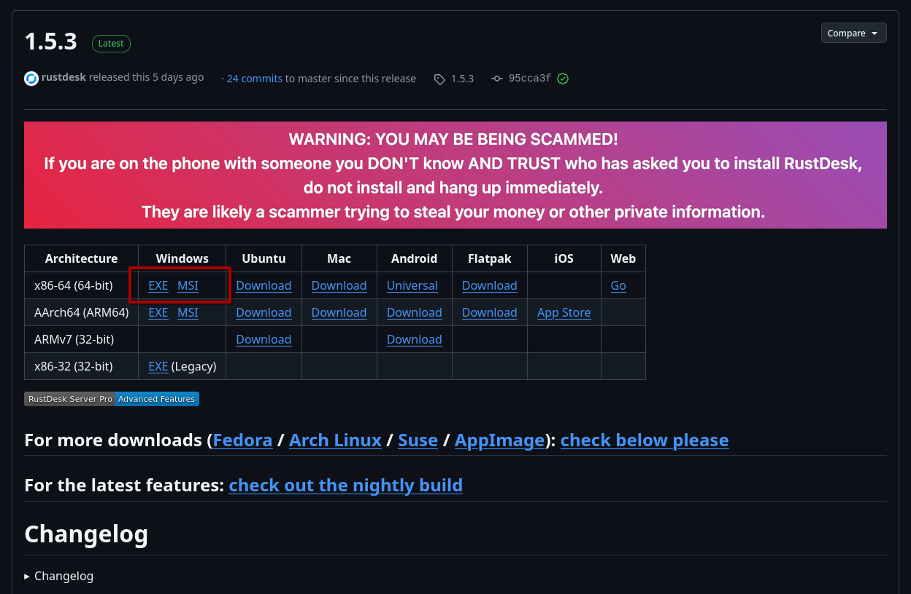
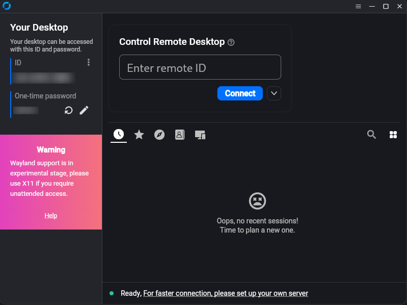

# RustDesk – Fjärrstyr en dator via internet

RustDesk är ett kostnadsfritt alternativ för fjärrsupport. Med programmet kan du se och styra en annan dator via internet, med hjälp av mus och tangentbord.

I den här guiden går vi igenom hur du installerar och använder RustDesk på Linux och Windows.

Vi använder RustDesks publika servrar, vilket innebär att du inte behöver konfigurera eller driva en egen server.

__Varning!__
Installera eller använd aldrig dessa verktyg tillsammans med någon du inte litar på. Dessa verktyg används av bedragare för att komma åt personliga uppgifter och för att få åtkomst till din dator. Har du blivit uppringd och ombeds att installera och köra dessa program ska du omedelbart lägga på och avbryta.
{: .notice--danger}

## 1. Installera RustDesk

### Linux – CachyOS / Arch Linux

Installera RustDesk via AUR med yay:

```bash
yay -S rustdesk
```

Starta programmet från programmenyn eller via terminalen:

```bash
rustdesk
```

Kontrollera installerad version:

```bash
rustdesk --version
```

### Windows

1. Besök [RustDesks nedladdningssida](https://rustdesk.com/download).
2. Ladda ner installationsfilen för Windows 64-bit.
   
3. Kör installationsprogrammet.
4. Starta RustDesk.

## 2. Konfigurera RustDesk

På båda datorerna ska RustDesk automatiskt ansluta till programmets publika servrar.

I huvudfönstret hittar du följande information:

- **Ditt ID:** Datorns unika RustDesk-ID.
- **Lösenord:** Tillfälligt lösenord för inkommande anslutningar.
- **Control Remote Desktop:** Fältet där du anger ID-numret till datorn du vill ansluta till.



Du behöver inte ändra några inställningar för nätverk eller konfigurera någon egen server.

## 3. Anslut från Linux till Windows

Följ dessa steg för att ansluta till en annan dator:

1. Be din vän starta RustDesk på sin Windows-dator.
2. Be vännen skicka sitt RustDesk-ID till dig.
3. Starta RustDesk på din Linux-dator.
4. Ange vännens ID i anslutningsfältet.
5. Klicka på **Connect**.
6. Ange det tillfälliga lösenordet som din vän delar med dig, eller följ instruktionerna för att godkänna anslutningen.
7. Vännens skrivbord visas i ett nytt fönster.

Nu kan du styra datorn med din egen mus och ditt tangentbord.

## 4. Linux och KDE Wayland

Om du använder KDE Plasma med Wayland finns det några extra saker att tänka på.

RustDesk använder PipeWire och XDG Desktop Portal för skärmdelning i Wayland.

När du startar en fjärranslutning:

1. Godkänn RustDesks begäran om skärminspelning.
2. Välj vilken skärm du vill dela.
3. Godkänn eventuella behörighetsförfrågningar.

Wayland-stödet är fortfarande experimentellt, så skärmdelning och fjärrstyrning kan behöva testas.

## 5. Säkerhet

Tänk på följande när du använder fjärrsupport:

- Använd tillfälliga lösenord istället för permanenta lösenord.
- Dela aldrig ID och lösenord med obehöriga.
- Avsluta anslutningen när du är färdig.
- Låt personen som får hjälp vara närvarande under fjärrsupporten, särskilt vid lösenordsinmatning och andra känsliga moment.

## Snabbguide

| Funktion | Linux (fjärrstyrande) | Windows (fjärrstyrd) |
|---|---|---|
| Installation | `yay -S rustdesk` | Ladda ner installationsfil |
| Starta | `rustdesk` | Starta programmet |
| Dela ID | Vid behov | Ja |
| Ange ID | Ja | Nej |
| Styra datorn | Ja | Godkänna anslutningen |
| Egen server | Behövs inte | Behövs inte |

## Länkar

- [RustDesk – officiell webbplats](https://rustdesk.com/)
- [RustDesk – nedladdningar](https://rustdesk.com/download/)
- [RustDesk – dokumentation](https://rustdesk.com/docs/en/client/)
